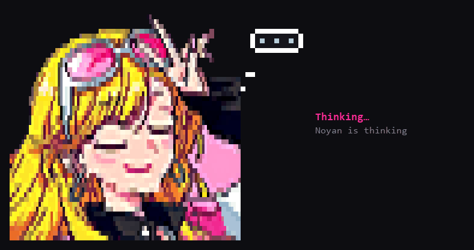

# noyan-kiz

A Claude Code mod that replaces the "thinking" spinner with an animated pixel-art girl drawn right in the terminal.



Noyan is the name I gave my Claude Code setup. While it works, she shows up next to the status text:

- **thinking**: a thought bubble with dots filling up
- **writing**: her mouth moves and she winks now and then
- **running a tool**: a progress bar slides through the bubble

She blinks in every state. The animation runs at 8 fps.

## How it draws

The portrait is 96x48 RGBA pixels, stored as base64 in `hooks/portrait-data.ts` (five variants: open, shut, blink, blink with mouth shut, wink).

Each terminal cell holds a 2x2 block of pixels using quarter-block characters (`▘ ▝ ▖ ▗ ▚ ▞ ▛ ▜ ▙ ▟ █`). A cell can only show two colors, so for every cell the renderer tries each split of the four pixels and keeps the one with the lowest color error. Transparent pixels fall through to the terminal background.

Frames are cached by pose. The timer only re-sends a frame when the pose actually changes, because re-blitting the same frame makes the terminal tear.

## Install

Copy the folder into your mods directory and restart Claude Code:

```
~/.claude/mods/noyan-kiz/
```

Type `/kiz` to turn her on or off. The setting is kept between sessions.

She only appears in a terminal that is at least 86 columns wide. In narrower windows the normal spinner is used.

## Layout

```
hooks/register.tsx      hooks into the Spinner render, the /kiz command and the frame timer
hooks/sprite.ts         poses, thought bubble, quarter-block encoder, frame cache
hooks/portrait-data.ts  the five portrait variants (generated)
tools/make.py           cuts the background off a source image and downscales it
tools/variants.py       paints closed eyes, closed mouth and wink, then exports portrait-data.ts
tests/kiz.test.tsx      frame size, base64 validity, blinking, no re-send of unchanged frames, /kiz fallback
```

The `tools/` scripts need Pillow and NumPy. The crop box and eye/mouth coordinates in `variants.py` are set for my reference image, so you will need to adjust them for your own picture.

## License

MIT
